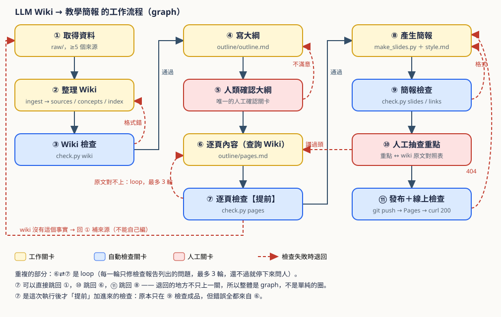
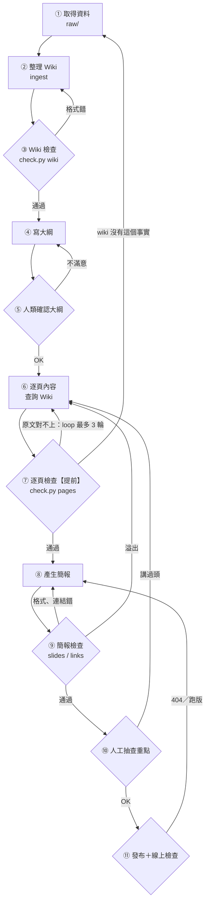

# 工作流程圖：從資料到教學簡報

（上圖是 [workflow.svg](workflow.svg)；在 GitHub 上看這份檔案，下面的 mermaid 也會畫成圖。）

## 每個節點在做什麼

| 節點 | 做什麼 | 產出 | 檢查／退回規則 |
|---|---|---|---|
| ① 取得資料 | 找來源，存成 raw/，寫網址、日期、英文原文摘錄 | raw/0X-*.md | 原文摘錄要能在抓下來的原文裡找到（verify_quotes） |
| ② 整理 Wiki | 一次 ingest 一個來源：寫 sources 摘要、更新 concepts／comparisons、index、log | wiki/ | — |
| ③ Wiki 檢查 | `check.py wiki`：雙向連結、孤兒頁、每句有 [Sx]、frontmatter 一致 | 檢查報告 | 失敗 → 回 ② |
| ④ 寫大綱 | 對象、目標、每頁要講什麼、**每頁用哪幾頁 wiki** | outline/outline.md | — |
| ⑤ 人類確認大綱 | 唯一一定要人看的地方（老師上課也說只檢查大綱就好） | — | 不滿意 → 回 ④ |
| ⑥ 逐頁內容 | 只用 wiki 寫每頁重點，每個事實用 `{{文字||wiki頁||原文}}` 標出處 | outline/pages.md | — |
| ⑦ 逐頁檢查【提前】 | `check.py pages`：原文找得到嗎？有沒有沒標出處的數字？ | 檢查報告 | 原文對不上 → 回 ⑥（loop，最多 3 輪）；wiki 根本沒有 → 回 ① |
| ⑧ 產生簡報 | `make_slides.py` 照 style.md 產生單一 HTML | slides/index.html | — |
| ⑨ 簡報檢查 | `check.py slides`（8–15 頁、出處、覆蓋率）、`check.py render`（headless Chrome 桌機／手機溢出）、`check.py links` | 檢查報告 | 格式錯 → 回 ⑧；溢出 → 回 ⑥ 縮短那頁 |
| ⑩ 審查 | 審查包（`tools/review_packet.py`）給新對話的 AI 審查忠實度／覆蓋率；加上看「重點 ↔ 原文」對照表人工抽查 | 審查意見、對照表 | 講反、講過頭 → 只回 ⑥ 修那頁 |
| ⑪ 發布 | git push → GitHub Pages → curl 每一頁都要 200 → 再截圖實際看畫面 | 網址、截圖 | 404 或跑版 → 回 ⑧（wiki 跑版回 ②） |

## Loop 規格（五件事）
| | 內容 |
|---|---|
| 🎯 目標 | 只用 wiki，產出教新手的 HTML 簡報 |
| 🚧 限制 | 不用 wiki 以外的知識；不手改 slides/index.html；不改 raw/ |
| ✅ 完成標準 | `check.py all` 結束碼 0（出處、原文、數字、8–15 頁、覆蓋 8 個來源、不溢出、連結）＋審查沒有講反／講過頭 |
| 🛑 停止條件 | 全過就停；同一格最多 3 輪；相關 wiki 頁少於 3 頁一開始就停 |
| ⏰ 觸發 | 輸入 `/topic-slides`，或 wiki 有新的 ingest 之後 |

Antigravity 版的 workflow 檔在 [.agents/workflows/topic-slides.md](https://github.com/b123090032-lab/llm-wiki-diffusion/blob/main/.agents/workflows/topic-slides.md)。

## 哪些步驟會重複？為什麼？
- **⑥ ⇄ ⑦ 是 loop**：寫逐頁內容最容易出錯（AI 會順手補上 wiki 沒有的知識），所以每寫完一輪就檢查，每輪只修檢查報告列出的問題。設 **最多 3 輪** 的停損點，還不過就代表 wiki 本身缺資料，停下來讓人決定。
- **⑦ → ① 是 graph 的跳回**：如果某個事實 wiki 裡根本沒有，不能在簡報裡自己編，要回到最前面補來源、ingest 進 wiki，再重新往下走。這次執行就真的發生了一次（補了 S8）。
- **每新增一個來源，② → ③ 都會重跑一次**：wiki 會越長越大，每次 ingest 都要重新 lint。

## 檢查放在哪裡？為什麼？
- **自動檢查**放在每一段產出之後（③⑦⑨⑪），因為程式檢查很便宜，越早抓到越省事。
- **人工檢查**只放兩個地方：⑤ 大綱（AI 想的方向可能跟我不一樣，越早糾正越好）和 ⑩ 抽查（程式只能檢查「原文存在」，不能判斷「原文有沒有真的支持這句話」）。
- ⑦ 是這次跑完一輪之後才「往前搬」的檢查，原因寫在 [反思](reflection.md)。
